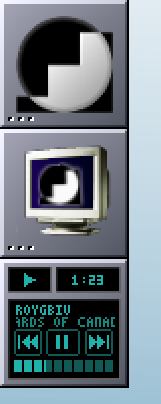
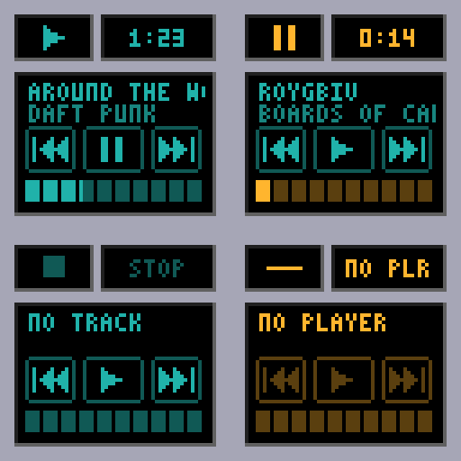

# wmmedia

A lightweight media-control dockapp for [Window Maker](https://www.windowmaker.org/), written in plain C and styled to match [wmvol](../wmvol/README.md).

> [!IMPORTANT]
> **AI-written software.** wmmedia was written entirely by Claude (Anthropic) from human requirements and feedback. This includes the C source, original Objective-C implementation, tests, man page, and README. Automated tests and selected real-world checks have been performed, but they do not cover every player, theme, display setup, or operating system. Independent code review and testing are welcome; see [What has been tested](#what-has-been-tested).



<sub>Shown in a Window Maker session under Xvfb (4×). Pixel-exact tile images: [8×](docs/tile-8x.png) or [original size](docs/tile.png).</sub>

## Overview

wmmedia puts media controls in a 64×64 dock tile. It provides previous, play/pause, and next controls; scrolling title and artist text; elapsed or remaining time; and a progress bar that supports click-and-drag seeking.

The tile uses the same three black, bevelled LCD panels and teal digits as wmvol. XShape masks the area around the panels so Window Maker's own dock texture remains visible.



<sub>Playing (teal), paused (amber), stopped, and no player (amber with controls disabled).</sub>

## Controls

| Input | Action |
|---|---|
| Left-click a playback key | Previous, play/pause, or next. The action fires on release; drag off the key to cancel. |
| Left-click or drag on the progress bar | Seek. During a drag, the target time is previewed; the seek is sent on release. |
| Left-click the time display | Switch between elapsed and remaining time |
| Mouse wheel | Adjust player volume by the configured step (default 5%). The time box and bar show the volume briefly. |
| Shift + mouse wheel | Adjust volume in 1% steps |
| Middle-click | Stop playback |

Right-click is reserved for Window Maker's dock menu. To move the tile, hold your Window Maker modifier (Alt by default) while dragging.

## Playback backends

wmmedia sends commands through an external player-control utility. It supports two backends:

- **`playerctl` (default):** controls MPRIS-compatible players, including Spotify, mpv, VLC, Firefox, and Chromium when they expose an MPRIS interface. Use `-p NAME` to select a particular player; otherwise, `playerctl` uses the first player it finds.
- **`mpc`:** controls MPD. Select it with `-b mpc`. Seeking uses whole-percent steps, matching the interface offered by `mpc seek`.

## Requirements

| Purpose | Requirements |
|---|---|
| Build | C compiler, `make`, libX11 and libXext development headers; `pkg-config` is used when available |
| Runtime | `playerctl` for MPRIS, or `mpc` for MPD |

wmmedia is written in POSIX C and has been tested on Linux. It does not require a toolkit.

### Install dependencies

<details>
<summary><strong>Debian / Ubuntu</strong></summary>

```sh
sudo apt install build-essential pkg-config libx11-dev libxext-dev playerctl
```
</details>

<details>
<summary><strong>Fedora</strong></summary>

```sh
sudo dnf install gcc make pkgconf-pkg-config libX11-devel libXext-devel playerctl
```
</details>

<details>
<summary><strong>Void Linux</strong></summary>

```sh
doas xbps-install -S base-devel pkg-config libX11-devel libXext-devel playerctl
```
</details>

<details>
<summary><strong>Arch Linux</strong></summary>

```sh
sudo pacman -S --needed base-devel pkgconf libx11 libxext playerctl
```
</details>

<details>
<summary><strong>Gentoo</strong></summary>

```sh
sudo emerge --ask --noreplace virtual/pkgconfig x11-libs/libX11 \
    x11-libs/libXext media-sound/playerctl
```
</details>

If you use MPD, install `mpc` through your distribution's package manager as well.

## Build and install

```sh
git clone https://github.com/Reedman27/dockapps-collection.git
cd dockapps-collection/wmmedia
make
```

Preview wmmedia in a normal window:

```sh
./wmmedia -w
```

Install under the default `/usr/local` prefix:

```sh
sudo make install
```

To uninstall, use the same prefix:

```sh
sudo make uninstall
```

Use `doas` instead of `sudo` where appropriate.

### Makefile options

The Makefile honours `CC`, `CFLAGS`, `LDFLAGS`, `PREFIX`, and `DESTDIR` from the environment or command line.

```sh
make CC=clang
make X11CFLAGS='-I/usr/X11R6/include' X11LIBS='-L/usr/X11R6/lib -lXext -lX11'
make install DESTDIR=/tmp/stage PREFIX=/usr
```

### Gentoo

The repository includes a live ebuild. Its optional `mpd` USE flag pulls in `mpc`.

```sh
sudo eselect repository add dockapps git https://github.com/Reedman27/dockapps-collection.git
sudo emaint sync -r dockapps
echo "x11-plugins/wmmedia **" | sudo tee -a /etc/portage/package.accept_keywords/dockapps
sudo emerge --ask x11-plugins/wmmedia
```

For MPD support:

```sh
echo "x11-plugins/wmmedia mpd" | sudo tee -a /etc/portage/package.use/dockapps
```

See the [collection README](../README.md#gentoo-overlay) for the complete overlay setup.

## Window Maker setup

Start wmmedia without `-w`:

```sh
wmmedia &
```

The tile appears as a loose dockapp icon near a screen corner. Hold Alt (or your configured Window Maker modifier) and drag it into the dock. Open its menu and enable **Start when Window Maker is started**.

Alternatively, add `wmmedia &` to:

```text
~/GNUstep/Library/WindowMaker/autostart
```

Use one startup method, not both, to avoid duplicate instances.

## Colours and themes

By default, wmmedia uses the same visual palette as wmvol:

- Teal digits (`20b2aa`) while playing
- Amber accents while paused or when no player is available
- Matching grey bevels and LCD panels

You can change the accent in two ways:

- `-fg RRGGBB` sets a fixed LCD colour.
- `-t` derives the accent from the active Window Maker theme.

With `-t`, wmmedia reads `~/GNUstep/Defaults/WindowMaker` and selects the most vivid available colour from `FTitleBack`, `IconTitleBack`, `MenuTitleBack`, `MenuTextBack`, and `UTitleBack`. It derives the LCD digit, glass, and dim shades from that accent. Grey themes produce a grey LCD; on amber or gold themes, the paused state switches to blue to remain distinguishable.

The defaults file is checked approximately once per second, so changing themes can update the tile without restarting wmmedia. Use `-c FILE` to read a different defaults file. If the file is missing or contains no usable colour, wmmedia falls back to teal.

`-fg` takes precedence over `-t`. The unit tests exercise all 36 themes shipped with Window Maker.

## Command-line options

```text
-display DPY   X display to use (-d also works)
-w             Run in a normal window instead of dock mode (preview only)
-b BACKEND     Backend: playerctl (default) or mpc
-p PLAYER      playerctl player name, such as spotify or mpv
-s N           Mouse-wheel volume step, 1–50% (default: 5)
-r             Start by showing remaining time instead of elapsed time
-fg RRGGBB     Fixed LCD colour (default: 20b2aa)
-t             Derive the LCD colour from the Window Maker theme
-c FILE        Window Maker defaults file used by -t
-D PREFIX      Write PREFIX-tile.ppm after the first poll, then exit
-v             Print version and exit
-h             Print usage and exit
```

Click the time display to switch between elapsed and remaining time while the application is running.

The legacy `-notheme` option from wmmedia 1.x is still accepted. Theme-derived colours are opt-in; the default remains the teal palette.

## Troubleshooting

**I cannot drag the tile.** Hold Alt (or your configured Window Maker modifier) while dragging.

**The tile appears as a normal window.** You started it with `-w`. Start wmmedia without that option to use dock mode.

**The keys are greyed out and the tile is amber.** wmmedia has not found a player. Start an MPRIS-compatible player, select one with `-p NAME`, or switch to MPD with `-b mpc`.

**The progress bar is empty.** Some streams and players do not report a track length. wmmedia can still show the time, but it cannot draw a meaningful progress bar without a duration.

**Clicking the progress bar does nothing.** The active player may not support seeking.

**Track names contain `?` characters.** The built-in 3×5 pixel font supports uppercase ASCII only. Characters outside that set are displayed as `?`.

## How it works

wmmedia is a single-threaded application built around `poll()` and short-lived, non-blocking subprocesses.

- **Polling:** the selected backend is queried with `playerctl metadata` or `mpc status` approximately every two seconds, or every three seconds when no player is available. After an action, it checks again after approximately 150 ms.
- **Subprocess handling:** helper processes are non-blocking and terminated after four seconds, preventing an unresponsive player command from holding up the interface.
- **Smooth time display:** elapsed time is extrapolated locally between polls and redrawn once per second.
- **Coalesced input:** wheel volume changes are combined into a relative volume command. The interface updates optimistically, and results from polls started before the latest action are discarded.
- **POSIX implementation:** uses `fork`, `execvp`, `pipe`, `poll`, `waitpid`, `sigaction`, and `clock_gettime`; it does not rely on Linux-only `prctl` or `pipe2` calls.
- **Small, testable components:** the source separates backend parsing and command construction, subprocess jobs, tile rendering, and application event scheduling. Parsing and hit-testing functions can be tested independently.

## Testing

Run the tests from this directory:

```sh
make test
make asan
```

`make test` runs unit and fuzz tests followed by the Xvfb integration test. `make asan` runs the same suite with AddressSanitizer and UndefinedBehaviorSanitizer.

The unit tests cover parsers (including malformed input and mutation fuzzing), clocks, hit areas, backend command construction, and theme handling.

The integration test runs the real wmmedia binary against fake `playerctl` and `mpc` scripts, sends synthetic mouse input, checks the commands issued (including seeking and dragging), and verifies rendered output.

The integration test requires `xvfb-run` and `xdotool`. Pixel comparisons also use ImageMagick's `import` and `compare` commands; those checks are skipped when ImageMagick is unavailable.

## What has been tested

The following checks were recorded for v2.1.0:

- Builds without warnings with GCC 13 using `-std=c99 -Wall -Wextra`.
- The complete test suite passes under AddressSanitizer and UndefinedBehaviorSanitizer.
- The C implementation renders pixel-identical tiles to the 2.0.0 Objective-C version in `-D` output comparisons for playing, paused, stopped, remaining-time, custom-colour, stream, and non-ASCII states.
- **Real MPD:** tested with `mpd` and `mpc` using a null output. Metadata, next, play/pause, wheel volume, seek, and stop were exercised through real mouse events.
- **Real `playerctl` 2.4.1 over D-Bus:** tested against a minimal MPRIS player. Position and length units (microseconds), play/pause, absolute seeking (`SetPosition`), and volume commands were checked.
- **Real Window Maker:** tested with Ubuntu's Window Maker under Xvfb. The tile was docked using Alt-drag, and its controls worked while it was a loose icon.

**Not yet tested:** a real music player such as Spotify, mpv, or VLC on a physical desktop; multi-monitor configurations; and BSD systems. Compatibility reports are welcome.

**Known limitation:** player state is polled rather than received through event notifications. Using a persistent `playerctl --follow` process would require reliable child cleanup that is not available through the current POSIX-only approach.

## Contributing

Bug reports, compatibility reports, code reviews, and pull requests are welcome through the [GitHub issue tracker](https://github.com/Reedman27/dockapps-collection/issues).

Please include your distribution, Window Maker version, player and version, `playerctl` or `mpc` version, reproduction steps, and relevant terminal output. Reports from physical desktops and non-Linux systems are especially useful.

## License

[MIT](LICENSE). Portions of the tile shaping, pixel font, and LCD style are derived from wmvol, which is also MIT-licensed.

The original Objective-C implementation (v2.0.0) is preserved in [`objc/`](objc/) for reference.
