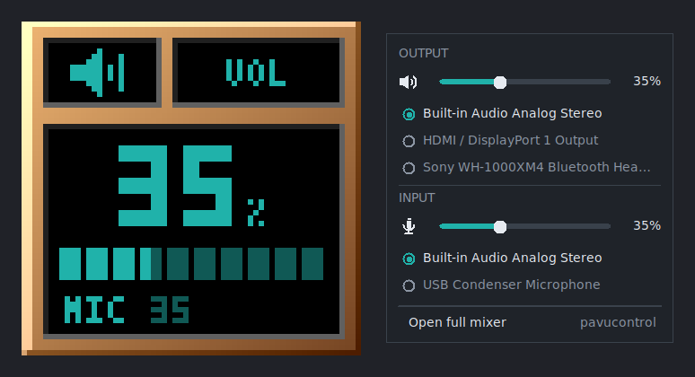

# wmvol

**A lightweight PipeWire volume dockapp for [Window Maker](https://www.windowmaker.org/), featuring a KDE-style popup mixer.**



<sub>Pixel-exact close-up of the dock tile: [docs/tile-8x.png](docs/tile-8x.png) (8x, nearest-neighbor; 1x original in [docs/tile.png](docs/tile.png)).</sub>

A 64×64 dock tile displays your default output volume. Click it to open a popup mixer for controlling output and input volume, toggling mute, and selecting audio devices.

wmvol brings modern audio controls to the traditional Window Maker desktop without requiring a full desktop environment.

## Features

* **Output and input controls** — adjust volume and toggle mute for your default audio devices.
* **Device selection** — choose the default output and input directly from the popup.
* **Mouse controls** — adjust volume, toggle mute, switch output devices, and open the full mixer.
* **Window Maker integration** — a shaped dock tile that lets your desktop theme show through.
* **Lightweight** — written in C using Xlib, Xft, and XShape, with approximately 4 MB RAM usage and negligible idle CPU usage.
* **Responsive updates** — uses `pactl subscribe` when available, falling back to polling.
* **Simple audio backend** — uses WirePlumber's `wpctl` for audio control.

For a pixel-perfect close-up of the dock tile, see [tile-8x.png](docs/tile-8x.png) (8× nearest-neighbor scaling) or [tile.png](docs/tile.png) (original size).

## Project status

This project was written entirely by Claude (Anthropic), an AI assistant, based on human requirements and feedback. The C source, tests, man page, CI workflow, and README were all AI-generated.

A human has built and run the application on Void Linux with Window Maker, but the source has not received a complete human line-by-line review.

Automated checks include warning-free builds, cppcheck, unit tests, Xvfb integration tests, and AddressSanitizer/UndefinedBehaviorSanitizer runs. These tests use a simulated `wpctl` backend and synthetic input; they do not verify compatibility with every real WirePlumber version, Window Maker theme, or multi-monitor configuration.

Independent code review and testing are welcome.

## Dependencies

wmvol is built from source. You need the following build dependencies:

* A C compiler
* make
* pkg-config
* X11 development libraries
* Xext development libraries
* Xft development libraries

At runtime, you need:

* **WirePlumber** — provides `wpctl`, the audio control backend.
* **PipeWire** — provides the audio server.
* **pactl** (optional) — enables event-driven updates through `pactl subscribe`.
* **pavucontrol** (optional) — provides the full mixer interface.

### Installing dependencies

Choose the commands for your distribution.

**Void Linux**

```sh
doas xbps-install -S base-devel pkg-config libX11-devel libXext-devel libXft-devel
doas xbps-install -S pipewire wireplumber pulseaudio-utils pavucontrol
```

**Debian / Ubuntu**

```sh
sudo apt install build-essential pkg-config libx11-dev libxext-dev libxft-dev wireplumber pipewire-pulse pulseaudio-utils pavucontrol
```

**Fedora**

```sh
sudo dnf install gcc make pkgconf-pkg-config libX11-devel libXext-devel libXft-devel wireplumber pipewire-pulseaudio pulseaudio-utils pavucontrol
```

**Arch Linux**

```sh
sudo pacman -S --needed base-devel pkgconf libx11 libxext libxft
sudo pacman -S --needed pipewire wireplumber pipewire-pulse libpulse pavucontrol
```

Additional dependencies for running the tests:

```sh
sudo pacman -S --needed xorg-server-xvfb python libxtst
```

**Gentoo**

The compiler is normally available through `@system`. Install the build dependencies:

```sh
sudo emerge --ask --noreplace dev-build/make virtual/pkgconfig \
    x11-libs/libX11 x11-libs/libXext x11-libs/libXft
```

Enable the PipeWire `sound-server` USE flag:

```sh
echo "media-video/pipewire sound-server" | sudo tee /etc/portage/package.use/pipewire
```

Install the audio components:

```sh
sudo emerge --ask media-video/pipewire media-video/wireplumber media-libs/libpulse media-sound/pavucontrol
```

If your Portage tree uses `sys-devel/make` instead of `dev-build/make`, use the package name provided by your tree. If `pactl` is unavailable, wmvol can fall back to polling.

**NixOS**

For NixOS, provide the same build and runtime dependencies through your system configuration or a development shell. wmvol is not currently packaged in nixpkgs.

## Building and installing

Clone the repository:

```sh
git clone https://github.com/Reedman27/wmvol.git
cd wmvol
```

Build the application:

```sh
make
```

Run it in a regular window first to test the mixer:

```sh
./wmvol -w
```

Once everything works, install it:

```sh
make install
```

The default installation prefix is `/usr/local`. If the destination requires elevated permissions, use `doas` or `sudo` as appropriate for your system.

To install under `/usr` instead:

```sh
make PREFIX=/usr install
```

To uninstall:

```sh
make uninstall
```

Use the same prefix that you used during installation.

## Window Maker setup

1. Launch the dockapp:

   ```sh
   wmvol &
   ```

2. Hold **Alt** and drag the tile into the Window Maker dock.
3. To start it automatically, open the docked tile's menu and enable **Start when Window Maker is started**.

Alternatively, add the following line to `~/GNUstep/Library/WindowMaker/autostart`:

```sh
wmvol &
```

Use one startup method rather than both to avoid launching duplicate instances.

## Controls

### Dock tile

| Input | Action |
|---|---|
| Left-click | Open or close the popup |
| Mouse wheel | Adjust output volume |
| Shift + mouse wheel | Adjust output volume in 1% increments |
| Middle-click | Toggle output mute |
| Right-click | Switch to the next output device |
| Ctrl + mouse wheel | Adjust input volume |
| Ctrl + middle-click | Toggle input mute |
| Ctrl + right-click | Open the full mixer |

The output device name scrolls across the tile's LCD display when necessary.

### Popup mixer

| Input | Action |
|---|---|
| Click speaker or microphone icon | Toggle mute |
| Drag a volume slider | Adjust volume |
| Click a device | Make it the default device |
| Mouse wheel | Adjust volume |
| Esc | Close the popup |
| Click outside the popup | Close the popup |

Increasing the volume of a muted device automatically unmutes it, matching KDE's audio control behavior.

Because the dock tile handles its own mouse clicks, hold your Window Maker modifier (Alt by default) while dragging it.

## Command-line options

```
-display DPY   X display to use
-w             Run in a normal window
-s N           Mouse-wheel volume step, 1–100 (default: 5)
-l N           Maximum volume, 10–200% (default: 100)
-m CMD         Command to launch the full mixer
-f FONT        Popup font, as an Xft pattern (default: sans-10)
-fg RRGGBB     LCD color (default: 20b2aa)
-D PREFIX      Dump PREFIX-tile.ppm and PREFIX-popup.ppm, then exit
```

The volume limit controls the maximum volume accepted by the application. Values above 100% may allow amplification beyond the normal software volume range.

## How it works

wmvol is a single-threaded C application built around `poll()` and non-blocking subprocesses.

* **Audio discovery:** `wpctl status` provides the output and input device lists and their audio state.
* **Volume control:** Changes are debounced and sent as absolute values, avoiding a subprocess for every wheel movement.
* **Event notifications:** `pactl subscribe` monitors audio-server events and triggers refreshes when available.
* **Fallback polling:** If `pactl` is unavailable, the application periodically refreshes its audio state.
* **Rendering:** Xlib handles drawing, Xft renders text, and XShape makes the areas surrounding the LCD display transparent.
* **Responsive interaction:** The interface updates optimistically and discards stale refresh results to prevent sliders from jumping backward while being dragged.

## Testing

Run the test suite:

```sh
make test
```

Run the tests with AddressSanitizer and UndefinedBehaviorSanitizer:

```sh
make asan
```

The tests include:

* Parser unit tests and mutation fuzzing.
* Xvfb integration tests using a fake `wpctl`.
* Synthetic mouse and keyboard input through XTest.
* Assertions checking the exact `wpctl` commands issued by the application.

The test suite requires Xvfb, Python 3, and the XTest development library. CI runs the automated tests on each push.

Passing automated tests does not guarantee compatibility with every real PipeWire/WirePlumber configuration.

## Packaging

wmvol currently documents building and installing directly from source. Distribution-specific packages may be added independently.

Contributions for distro-native packaging are welcome, including:

* Arch Linux AUR packages
* Void Linux XBPS templates or repository packages
* NixOS packages
* Debian packages
* Fedora RPMs
* Gentoo ebuilds

Package availability and maintenance should be documented here once the corresponding packages actually exist.

## Contributing

Bug reports, code reviews, compatibility reports, and pull requests are welcome.

If wmvol misparses `wpctl status`, please include the raw command output and your WirePlumber version.

When reporting an issue, include your distribution, Window Maker version, PipeWire/WirePlumber versions, reproduction steps, and relevant terminal output.

## License

Licensed under the MIT License.
